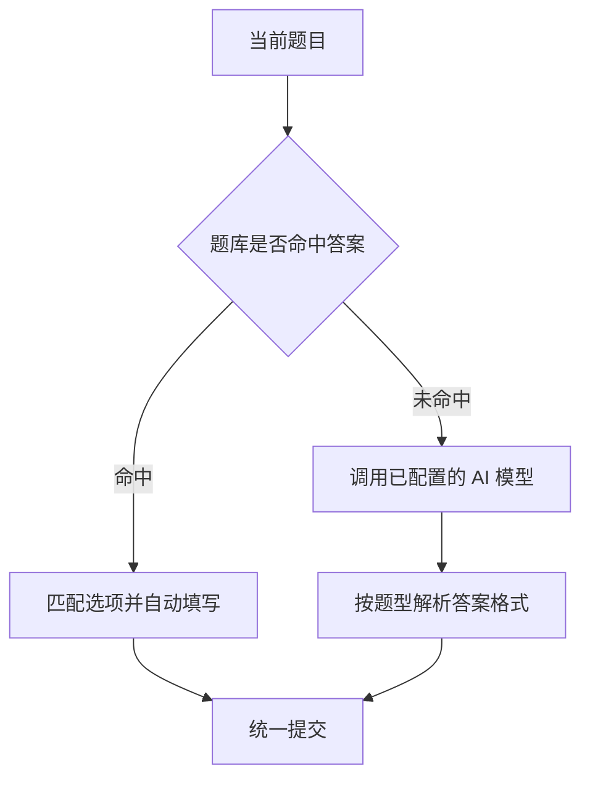

# 学习通AI满分助手

> 超星学习通自动答题油猴脚本 · 多模型 AI 兜底 · 全题型自动填写
>
> 基于超星学习通满分助手二次开发，题库命中则自动填答，未命中时调用 DeepSeek / OpenAI / Kimi / 智谱GLM / 通义千问补全答案。

---

## 目录

- [一、项目介绍](#一项目介绍)
- [二、功能特性](#二功能特性)
- [三、支持题型](#三支持题型)
- [四、模型配置](#四模型配置)
- [五、安装步骤](#五安装步骤)
- [六、使用说明](#六使用说明)
- [七、自动更新机制](#七自动更新机制)
- [八、常见问题](#八常见问题)
- [九、更新日志](#九更新日志)
- [十、免责声明与许可证](#十免责声明与许可证)

---

## 一、项目介绍

本脚本运行在超星学习通（超星泛雅 / 学习通网页版），在原有满分助手基础上二次开发，负责章节视频、音频任务点的自动处理，以及测验、作业、考试的自动搜题与填答。

整体答题流程如下：

核心能力：

- 自动播放视频、音频任务点
- 多题库并发检索，命中即自动填答
- 题库缺失时由 AI 模型兜底作答
- 单选、多选、判断、填空、简答等全题型覆盖
- 可视化配置面板，参数本地保存
- 内置自动更新，发布新版后已安装用户可自动获得更新

---

## 二、功能特性

### 核心功能

- [x] 自动视频播放：静音自动播放视频任务点（默认 2 倍速，降低平台进度与心跳检测风险），以实际课程为准
- [x] 自动音频播放：自动播放音频任务点
- [x] 自动答题：章节测验、作业、考试自动搜题填答案
- [x] 自动切换章节：完成后自动跳转下一章节
- [x] 自动提交：答完自动提交试卷 / 作业

### AI 答题功能

- [x] 多模型支持：DeepSeek / OpenAI / Kimi / 智谱GLM / 通义千问
- [x] 全题型覆盖：单选、多选、判断、填空、简答、名词解释、论述、计算
- [x] 智能匹配：自动识别选项文本、数值与字母答案
- [x] 答案拆分：填空题按空拆分，逐空填入
- [x] 可视化配置：在面板内直接填写 API Key

### 自动更新

- [x] 油猴原生更新：通过 `@updateURL` / `@downloadURL` 声明更新源，定期自动检查并静默更新
- [x] 安装方式全覆盖：在线链接安装、本地粘贴安装，v2.1.9 及以上版本均进入自动更新轨道
- [x] 版本检查提示：打开页面立即联网比对版本号，常驻页面每 10 分钟轮询一次，发现新版右下角弹出更新提示

### 界面体验

- [x] 悬浮面板：可拖动的悬浮助手按钮
- [x] 运行状态：实时显示答题进度与当前题目
- [x] 运行日志：记录关键操作过程
- [x] 自动保存：配置修改后自动写入本地存储

---

## 三、支持题型

| 题型 | 题库填写 | AI 兜底 |
|------|:------:|:------:|
| 单选题 | 支持 | 支持 |
| 多选题 | 支持 | 支持 |
| 判断题 | 支持 | 支持 |
| 填空题 | 支持 | 支持 |
| 简答题 | 支持 | 支持 |
| 名词解释 | 支持 | 支持 |
| 论述题 | 支持 | 支持 |
| 计算题 | 支持 | 支持 |

---

## 四、模型配置

面板内「AI 服务商」为下拉选择，选定后自动填入接口地址与默认模型 ID，只需再填写 API Key；默认值均可手动修改。下表为各家接入参数参考：

| 服务商 | API 地址 | 默认模型 ID（请以实际为准） | 备注 |
|------|---------|---------|------|
| DeepSeek | `https://api.deepseek.com/v1` | `deepseek-chat` | 国内直连 |
| OpenAI | `https://api.openai.com/v1` | `gpt-4o-mini` | 国内需代理 |
| Kimi（月之暗面） | `https://api.moonshot.cn/v1` | `kimi-k3` | 国内直连 |
| 智谱 GLM | `https://open.bigmodel.cn/api/paas/v4` | `glm-4-flash-250414` | 免费模型 |
| 通义千问 | `https://dashscope.aliyuncs.com/compatible-mode/v1` | `qwen-plus` | 国内直连 |

> 模型 ID 对应请求体中的 `model` 字段，必须填写官方真实模型 ID；模型会随官方版本迭代调整，请以各平台最新模型列表为准，填写错误会返回 `invalid model` / `model_not_found` 类报错。
>
> API Key 在各模型官方平台申请，仅保存在本机油猴存储中，不会上传到其他服务器。
>
> OpenAI 接口在国内网络通常无法直连，需要浏览器开启代理后使用；其余四家国内可直连。

---

## 五、安装步骤

### 1. 安装油猴扩展

根据浏览器选择对应扩展：

- Chrome / Edge：[Tampermonkey（篡改猴）](https://www.tampermonkey.net/)
- Firefox：[Violentmonkey（暴力猴）](https://violentmonkey.github.io/)

### 2. 安装脚本

**方法一：直接安装（推荐）**

点击下方链接，浏览器会弹出油猴安装确认页，确认即可：

[**点击安装学习通AI满分助手**](https://cdn.jsdelivr.net/gh/LMCome/xuexitong-ai-assistant@main/xuexitong-ai-assistant.user.js)

> 提示：若页面长时间停留在"正在加载脚本数据"，稍等片刻；仍无反应则改用方法二手动安装。

**方法二：手动安装（最稳定）**

1. 下载脚本文件：[xuexitong-ai-assistant.user.js](https://github.com/LMCome/xuexitong-ai-assistant/raw/main/xuexitong-ai-assistant.user.js)
2. 打开油猴扩展仪表盘，点击「+」新建脚本
3. 清空默认内容，将下载脚本全文复制粘贴进去
4. 按 `Ctrl + S` 保存

> 重要：请安装 **v2.1.9 及以上版本**。自动更新声明从该版本开始内置；更早版本无自动更新能力，需手动升级一次。

### 3. 配置 AI API

1. 打开任意超星学习通页面
2. 点击右下角绿色「满分助手」按钮
3. 进入「设置 / 授权码」面板，切换到「AI答题」标签
4. 开启「启用 AI 答题」
5. 在「AI 服务商」下拉选择对应厂商，确认自动带出的接口地址与模型 ID，填写 API Key
6. 刷新页面后生效

---

## 六、使用说明

### 基础参数

| 参数 | 说明 | 默认值 |
|------|------|:------:|
| 通用间隔 | 脚本切换任务点的等待时间（秒） | 3 |
| 答题间隔 | 每道题之间的等待时间（秒） | 3 |
| 最低正确率 | 低于该正确率不自动提交 | 80% |

### 章节开关

- 自动答题：开启后自动答章节测验
- 自动视频：开启后自动播放视频
- 自动切换：开启后自动切换下一章节
- 自动提交：开启后自动提交答案

### AI 参数

- 启用 AI 答题：题库无答案时自动调用模型
- AI 服务商：下拉选择厂商，选定后自动带出接口地址与默认模型 ID
- API 地址：选择后自动填入，可手动修改
- 模型名称：默认模型 ID，请以官方实际为准，可手动修改
- API Key：对应平台申请的密钥

---

## 七、自动更新机制

### 工作原理

脚本通过两层机制保证用户使用最新版本：

1. **油猴原生静默更新（主力）**
   - 脚本头声明 `@updateURL`（检查地址）与 `@downloadURL`（下载地址）
   - 油猴按自身周期（Tampermonkey 默认约每天一次）拉取更新源，比对 `@version`
   - 版本更高时自动下载替换，刷新页面即生效，无需手动操作
   - 不区分安装来源，脚本头含声明即适用

2. **脚本内版本检查（补充，响应更快）**
   - 打开学习通页面时立即读取远程脚本版本号，与本地版本比对
   - 页面常驻期间每 10 分钟轮询一次；更新探测按 GitHub 代理镜像 gh-proxy.com、ghproxy.net 优先，jsDelivr 各节点与 raw 兜底的顺序轮询，单源超时或失败自动切换，兼顾可达性与版本新鲜度
   - 发现新版时右下角弹出更新提示条，点击直接打开安装确认页，确认后即覆盖更新
   - 同一新版本只提示一次，升级到最新版后自动清除提示标记，避免反复打扰

> **能力边界说明**：浏览器未打开、脚本未运行时无法主动推送；油猴沙箱也不允许脚本在后台静默改写自身源码。因此“发布后尽快收到”的实际表现是：用户下次打开学习通页面立即探测，页面挂着时 10 分钟内探测；提示出现后点击确认一次即完成更新。这是在油猴扩展限制内最及时的方案。

### 手动检查更新

- Tampermonkey：扩展面板 → 脚本管理 → 点击脚本右侧「检查更新」图标
- Violentmonkey：扩展面板 → 脚本列表 → 右键 → 检查更新
- 也可直接重新点击安装链接覆盖一次

### 发版流程（维护者）

1. 将脚本头部 `// @version` 按语义化版本递增（如 `2.2.0` → `2.2.1`），界面版本号同步修改
2. 将更新后的脚本覆盖上传至 `main` 分支
3. 已安装用户下次打开学习通页面立即探测到新版并收到提示；油猴自身周期也会静默更新
4. 扩展更新地址使用国内可达的 GitHub 代理镜像（gh-proxy.com 主、ghproxy.net 备，直出最新源码，不受 CDN 缓存旧版影响）；jsDelivr CDN 与 raw 作为备用源，页面内探测自动切换

---

## 八、常见问题

**Q：页面上看不到悬浮按钮？**

> A：依次检查：脚本是否已启用；当前页面是否为 chaoxing.com 等学习通域名；刷新页面后重试。

**Q：开启了 AI 答题但不生效？**

> A：检查是否打开「启用 AI 答题」开关；核对 API Key、API 地址是否填写正确；按 F12 打开控制台查看报错信息。

**Q：多选题选不全或选错？**

> A：AI 回答格式可能不规范，可在配置中调整提示词，或对该题手动确认。

**Q：安装时卡在"正在加载脚本数据"？**

> A：分三种情况。一是脚本引用多个前端 CDN 资源，安装阶段预加载较慢，可稍等或用方法二手动粘贴安装跳过预加载；二是若提示“加载脚本数据发生错误，HTTP 502”，通常是当前网络到 GitHub raw 节点不稳，直接改用方法二下载本地脚本粘贴安装最稳妥；三是若能打开安装页但标题显示的版本明显偏旧（如打开后仍是 2.2.0 / 2.2.2），这是 jsDelivr 边缘节点缓存了历史版本，切换为代理镜像地址或方法二手动粘贴最新文件即可。脚本内部版本探测已做多源轮询，单个节点超时、失败或版本偏旧时会自动切换到其他可用节点。

**Q：新版发布后如何收到更新？**

> A：脚本打开页面即探测版本、常驻页面每 10 分钟轮询，发现新版右下角弹出提示，点击确认即更新；油猴自身也会按周期静默更新。浏览器关闭时不会主动推送，下次打开页面即检测。若脚本设置里“下载更新地址”为空（早期手动粘贴的旧副本，如 Violentmonkey 中的 v2.1.8），自动更新无从触发，必须手动覆盖一次最新版，之后才进入更新轨道。

---

## 九、更新日志

**v2.2.5（2026-10-29）**

按实测可达性调整更新源优先级：

- 主更新源由 ghproxy.net 对调为 gh-proxy.com（实测当前网络可达且直出最新版），ghproxy.net 降为备用；`@updateURL` / `@downloadURL`、更新提示跳转地址、页面探测第一顺位同步切换
- 探测顺序：gh-proxy.com → ghproxy.net → fastly / cdn / gcore 等 jsDelivr 节点 → raw，任一源超时自动切换
- 说明：shturl.cc 等第三方短链或代理若域名无法解析（浏览器报 DNS_PROBE_FINISHED_NXDOMAIN）即不可用，脚本不内置此类地址；请使用 README 给出的镜像链接或手动粘贴最新文件

**v2.2.4（2026-10-29）**

解决 jsDelivr 节点缓存旧版本、部分节点国内连接被重置的问题：

- 扩展安装与检查更新主源由 jsDelivr CDN 切换为 GitHub 代理镜像（ghproxy.net，备用 gh-proxy.com），直接拉取最新 main 分支源码，不受 CDN 缓存滞后影响；更新请求只读取公开脚本文本，不传输本地保存的 API Key，AI 答题请求仍直连各模型官方接口
- 页面内探测源调整优先级：代理镜像优先，fastly / cdn / gcore 等 jsDelivr 节点与 raw 作为兜底，任一源超时 8 秒自动切换下一源
- 更新提示条的安装跳转改用代理镜像地址，避免点开后落到缓存旧版

**v2.2.3（2026-10-29）**

修复扩展安装页“正在加载脚本数据 / HTTP 502”问题，提升更新源可达性：

- 扩展安装与油猴检查更新地址（`@updateURL` / `@downloadURL`）由 GitHub raw 改回 jsDelivr CDN 主域；raw 在国内网络易超时或返回 502，不适合作为扩展直连源
- 页面内版本探测改为多源轮询：按 fastly、cdn、gcore 等 jsDelivr 节点与 raw 顺序尝试，单源超时或失败自动切换下一源，保证至少一个节点可用
- 更新提示条的跳转地址使用稳定 CDN，点击后可正常打开安装确认页

**v2.2.2（2026-10-29）**

修复更新检查“点了却说没有更新”的问题：

- 油猴原生 `@updateURL` / `@downloadURL` 由 jsDelivr CDN 改为 GitHub raw 直链，消除 CDN 缓存导致扩展侧检查更新时仍读到旧版本的问题
- 页面内更新提示的跳转地址同步改用 raw 直链，安装即时生效
- 补充说明：早期手动粘贴、缺少更新地址的旧副本（如 Violentmonkey 中的 v2.1.8）无法被自动升级，需手动覆盖一次最新版

**v2.2.1（2026-10-29）**

提升更新响应速度，让发布后的新版更快送达已安装用户：

- 版本探测由“6 小时节流”改为打开页面立即执行，页面常驻期间每 10 分钟轮询一次
- 探测源优先 GitHub raw 文件（接近实时），读取失败自动回退 jsDelivr CDN
- 同一新版本只提示一次，升级到最新版后自动清除提示标记，避免重复打扰
- 更新提示条增加关闭按钮，主操作一键跳转安装确认页
- 说明：浏览器关闭时无法主动推送，脚本也无法在沙箱内静默替换自身源码，点击提示确认一次即完成更新

**v2.2.0（2026-10-29）**

稳定性与安全修复版本，在不改变原有答题流程的前提下收敛已知风险点：

- 安全防护：AI 返回文本写入填空、简答编辑器前统一清洗，移除脚本标签、事件属性与 `javascript:` 协议，避免注入内容污染页面
- 网络兼容：`@connect` 增加通配声明，自定义 API 地址（含第三方中转、反代）不再被跨域拦截；接口地址自动去除结尾斜杠，避免重复拼接 `/chat/completions`
- 接口健壮性：AI 请求先判断 HTTP 状态码，401 / 402 / 403 / 429 等异常直接记录并跳过，不再把错误响应当作答案解析；API Key 为空时跳过 AI 兜底并在控制台提示，写入前自动去除首尾空格
- 答题解析：选择题字母答案在无“答案”前缀时也可识别（如直接返回 `A`、`ABD`）；判断题正则收敛为“正确 / 错误”核心词，去掉“是 / 否 / T / F”等易被解释性文字误命中的单字；填空题兼容“第一空：”“1. ”“空1”与逐行拆分等多种返回格式
- 运行稳定性：视频倍速由 16 倍降至 2 倍，降低平台检测风险；答题循环内每次重新读取配置，运行中修改设置即时生效
- 工程维护：AI 增强模块增加分节注释，便于后续定位修改；前端框架依赖（Vue、Element Plus、Pinia、jQuery 等）保留 CDN 加载，未做全量内联以避免引入运行风险

**v2.1.9（2026-10-29）**

- 新增油猴原生自动更新声明（`@updateURL` / `@downloadURL`），在线安装与本地安装均可自动更新
- 新增脚本内版本检查模块，发现新版自动弹出一键更新提示（6 小时节流）
- 修复界面版本号硬编码问题，版本号统一从 `GM_info.script.version` 读取

**v2.1.8（2026-10-28）**

- 新增多模型 AI 答题功能
- 支持 DeepSeek / OpenAI / Kimi / 智谱GLM / 通义千问
- 优化选择题匹配逻辑（文本 / 数值 / 字母三重匹配）
- 填空题自动拆分答案
- 多选题支持多选匹配
- 修复多个已知问题

**v2.1.7**

- 原始版本功能

---

## 十、免责声明与许可证

> 1. 本脚本仅供学习交流使用，请勿用于商业用途。
> 2. 脚本不对题库准确率与 AI 回答准确性负责，使用后果由使用者自行承担。
> 3. 请遵守所在学校的相关规定，合理使用工具。

**许可证**：MIT License，可自由使用、修改与分发。
